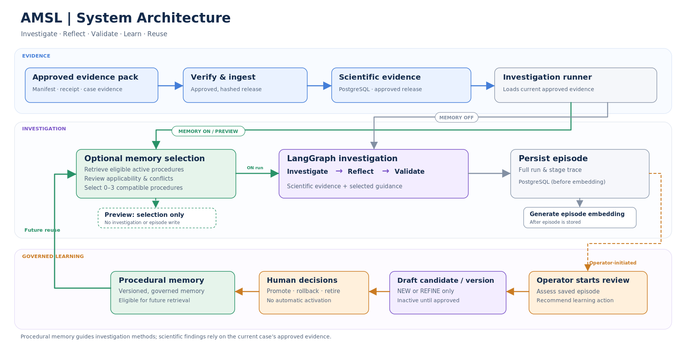

# AMSL | Agent Memory and Self-Learning Lab

AMSL (Agent Memory and Self-Learning Lab) is an AI investigation system designed to **learn reusable investigation methods from its own experience** and apply them to future cases. Its learning is procedural: it captures *how to investigate*, while keeping scientific evidence and conclusions tied to the case being examined.

The system works with case-scoped scientific evidence approved through the project's release process. For each investigation, a LangGraph agent examines the sources, reflects on its approach, and runs structured model-based validation of its report and proposed lesson against the supplied evidence. AMSL saves the investigation record, stage outputs, and source provenance. A separate, operator-initiated learning process can assess a proposed lesson, create an inactive memory candidate or revised version, and present it for human approval.

During a later investigation, AMSL can retrieve relevant approved procedural memories using the new case's evidence and the fixed investigation question. It reviews applicability and potential conflicts, then selects up to three compatible procedures to guide the agent. Memory can also be turned off, or its selection previewed without running a new investigation.

For example, a learned procedure might guide the agent to cross-check each criterion against its exact guideline definition and the corresponding source passage. **The procedure guides how the agent investigates; its scientific conclusions must be supported by the current case's approved evidence.**

AMSL focuses on **governed procedural learning and reuse**. It does not retrain the underlying language model, automatically activate its own proposed memories, or treat agent-generated procedures as scientific evidence. Human operators control memory promotion, rollback, and retirement; refinements are proposed as new versions for approval.

## Experimental use case

AMSL uses a controlled **genetic-variant evidence investigation** scenario to explore whether reusable *investigation methods* can be learned from one case and applied to another. Each investigation works from an independently approved, case-scoped evidence release, including an interpretation record and guideline criteria, with supporting ClinVar or publication records where authorized. The agent examines source-specific evidence, reports uncertainties, and may propose a repeatable procedure for future investigations.

For example, one learned method guides the agent to trace individual criteria to the relevant guideline definitions and supporting source fields. Another focuses on case-level evidence traceability and independence. These are **procedural lessons about how to investigate**, not scientific conclusions that can be transferred between cases. Reuse is subject to memory eligibility, applicability review and operator-governed activation; each investigation's scientific findings must come from its own approved evidence.

This is a bounded AI-engineering experiment, **not a clinical decision-support system or a validated genetic-classification tool**. Observed differences between memory-enabled and memory-disabled investigations do not establish improved scientific accuracy.

## Public repository scope

This repository shares AMSL's proof-of-concept implementation, architecture, database schema and offline regression tests. The six original controlled investigations, their evidence releases, and the associated experimental records are retained in the private research workspace; those materials are not distributed here.

In the original controlled experiments, AMSL demonstrated procedural-memory creation and reuse, with observable differences in analytical structure and traceability. As an experimental proof of concept, it implements selected safeguards; broader governance, rigorous evaluation of learning effectiveness and production readiness are outside its current scope.

The public code and offline tests can be examined independently, but this repository does not provide a turnkey reproduction of the historical investigations.

## System design



[System overview](docs/system_overview.md) · [Detailed investigation and learning process flow](docs/process_flow.md)

### Investigation and learning flow

1. **Evidence release:** `verify_evidence_release.py` checks a released evidence pack; `ingest_approved_evidence.py` ingests the approved sources and release metadata into PostgreSQL.
2. **Investigation:** `run_investigation_to_db.py` loads approved case evidence from PostgreSQL and dispatches the Docker-based LangGraph worker. The graph executes **Investigate → Reflect → Validate**.
3. **Optional memory reuse:** With `--use-multi-memory`, `procedural_retrieval.py` ranks active, provenance-qualified memory versions using pgvector. A separate LLM applicability review returns `APPLY`, `SKIP`, or `UNCERTAIN` and identifies potential conflicts. Deterministic checks select **zero to three** compatible procedures for the investigation. The default run is memory-OFF.
4. **Persistence:** `episode_persistence.py` saves the complete run record and stage trace first, then attempts the episode embedding. `verify` checks the stored record hash; `replay` reads back the record without rerunning the model.
5. **Learning governance:** Separately and **only when invoked by an operator**, `govern_procedural_lessons.py` assesses a saved, eligible episode and can obtain a `NEW`, `REFINE`, `REINFORCE`, `SUPERSEDE`, `INVALIDATE`, or `NO_CHANGE` recommendation. `draft-learning` creates inactive drafts **only for `NEW` or `REFINE`**. Promotion, rollback, reinforcement observations, and retirement remain operator-controlled.

### Persistence and embeddings

| Data | PostgreSQL storage | Creation / use |
| --- | --- | --- |
| Approved scientific evidence | `scientific.sources`, `scientific.evidence_releases`, `scientific.release_evidence` | Released evidence, manifest, receipt, and source provenance |
| Scientific-source vectors | `scientific.source_embeddings` | Explicit scientific index/search commands; not automatically used by the LangGraph investigation |
| Investigation episodes | `agent_memory.episodes` | Full JSON run record, validation, trace, SHA-256 verification and replay |
| Episode vectors | `agent_memory.episodes.episode_embedding` | Attempted after episode persistence; used by explicit episode semantic search |
| Procedural memories and versions | `agent_memory.memories`, `agent_memory.memory_versions` | Inactive drafts, approved active versions and version history |
| Procedural-memory vectors | `agent_memory.embeddings` | Created when versions are stored; active eligible versions are used for retrieval and learning comparison |
| Human decisions | `agent_memory.validations` | Records operator governance actions |

Embeddings use local **Ollama / `embeddinggemma:latest`** with 768 dimensions. Investigation, applicability and learning-review model calls use the configured OpenAI-compatible model. External model calls require explicit opt-in. A model's `APPROVE` decision is not a human approval to activate a procedural memory.

## Core capabilities

- LangGraph investigation with a case-grounded report, reflection that may propose a procedural lesson, and structured model validation.
- Exact JSON Pointer evidence references required for lesson `APPROVE`; unresolved references prevent approval.
- Approved, case-scoped evidence with release provenance and source hashing.
- Persistent, hash-verified investigation episodes and optional episode semantic search.
- Versioned procedural memory, human promotion, rollback, retirement and auditable decisions.
- Context-aware procedural retrieval, LLM applicability and conflict review, and controlled zero-to-three-memory injection.
- Memory-OFF, preview-only, and memory-ON modes, with selection provenance in saved memory-ON episodes.

## Repository structure

```text
db/baseline/       Database schema for a new, empty installation
scripts/           Evidence, runner, retrieval, persistence and governance utilities
src/               LangGraph investigation stages
tests/             Offline regression tests
docs/              High-level architecture image, editable overview and detailed process flow
```

## Setup

AMSL is a research proof of concept, not a turnkey deployment package. The offline tests below can run without the original research data; full investigations require additional infrastructure and separately authorized evidence.

1. Install Python, Docker, PostgreSQL 17 with pgvector, and Ollama. Install the Python dependencies and build the included LangGraph worker image:

   ```powershell
   python -m pip install -r requirements.txt
   docker build -t agent-memory-lab:dev .
   ```

2. Configure PostgreSQL. The database access helper currently expects a **running Docker container named `agent-memory-postgres`**, containing database `agent_memory_lab` and user `agent_memory`. Container provisioning and credential configuration are not automated in this repository. Apply [`db/baseline/001_fresh_install.sql`](db/baseline/001_fresh_install.sql) **only to a new, empty database** with pgvector enabled; do not apply it to an existing research database.
3. Start local Ollama and make the `embeddinggemma:latest` embedding model available at its configured local endpoint.
4. Configure `OPENAI_MODEL` and `OPENAI_API_KEY` for the language-model endpoint; set `OPENAI_BASE_URL` only when using a compatible custom endpoint. External model calls require explicit `--allow-external-model` authorization, and evidence must be approved for transfer to the chosen endpoint.
5. For an investigation, prepare a **compatible, case-scoped evidence release** with the required manifest, receipt, inventory and source provenance; verify and ingest it before execution. The historical evidence and private `scientific_data/` workspace are not distributed here. Case-specific verifier checks may require adaptation for other evidence domains.

## Offline regression tests

From the repository root, run:

```powershell
python -B -m unittest discover -s tests -v
```

The offline suite covers evidence validation, investigation boundaries, procedural retrieval, memory governance, provenance and persistence using test fixtures and mocks. The historical release-verification test is **skipped** when the original private case inventories are unavailable. Passing these tests does not demonstrate an end-to-end investigation or reproduce the historical experimental outcomes.

## Running investigations

A live run requires the infrastructure above, an approved evidence release compatible with the verifier and an appropriately configured model. The underlying historical experiments cannot be replayed from this public repository alone. AMSL is not a production-ready or clinically validated system.

## Development Approach: Human-Led, AI-Assisted Engineering

AMSL was developed using an AI-assisted engineering approach, with OpenAI Codex and ChatGPT supporting implementation, debugging, code refinement and documentation.

The technical vision, design decisions, experimental methodology, governance principles and interpretation of findings were human-directed. AI served as an engineering accelerator, while responsibility for technical decisions, validation and conclusions remained with the owner.

This approach reflects a broader shift in software engineering, where AI can accelerate implementation while human judgment continues to guide innovation, experimentation and accountability.

## License and reuse

No open-source license is included with this repository at present. Public availability of the source code does not itself grant permission to reuse or redistribute it; licensing and any required ownership or third-party permissions must be resolved separately.

