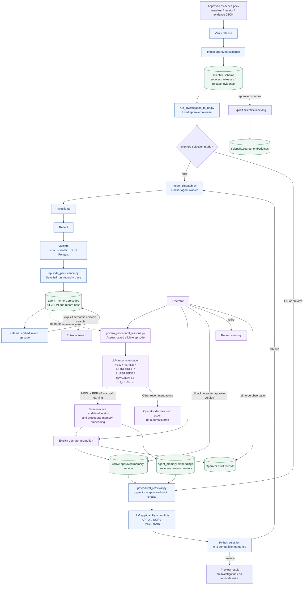

# AMSL | Process Flow

## Execution boundaries

- The runner uses the **approved scientific release in PostgreSQL**, not unchecked local evidence files.
- Memory applicability is an **LLM call outside LangGraph**; the selected procedures are guidance, not scientific evidence.
- `--preview-multi-memory` runs retrieval and applicability but stops before investigation and persistence.
- A completed investigation is **saved before** its episode embedding is attempted; embedding can be retried.
- Learning assessment and memory governance are **operator-initiated**, not invoked automatically by the runner. Only `NEW` and `REFINE` recommendations can create inactive drafts through `draft-learning`.
- Procedural-memory embeddings are stored with candidate versions; **active approved versions** are eligible for reuse.
